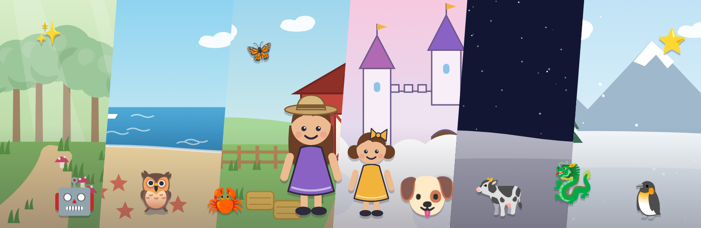
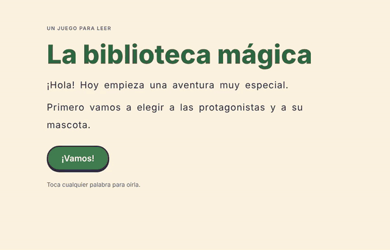
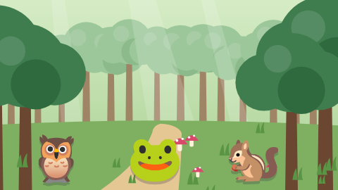
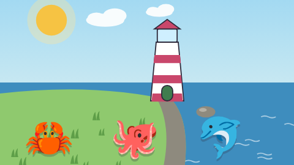
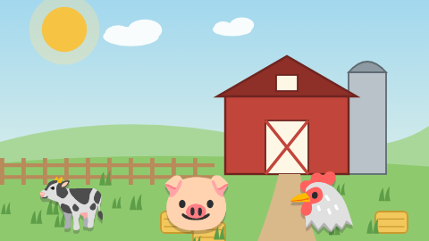
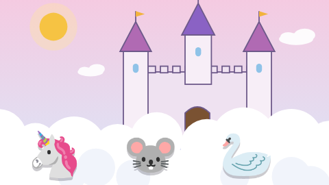
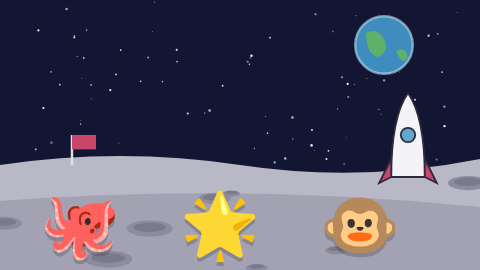
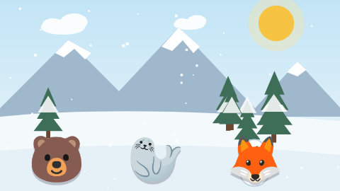
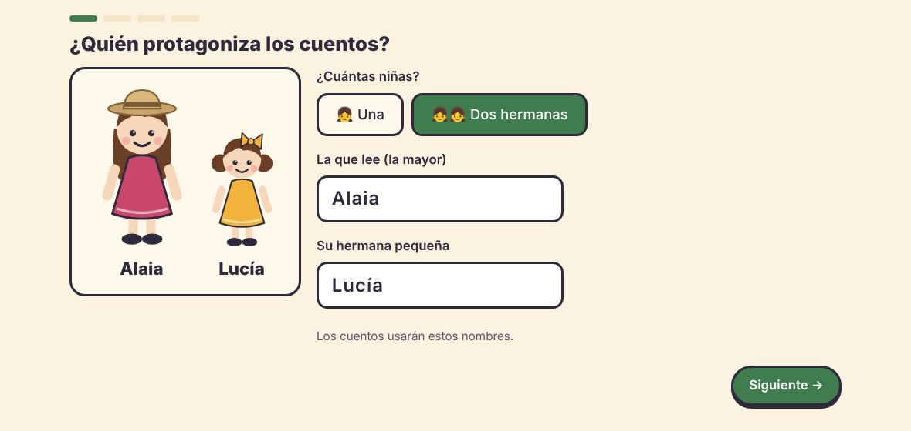
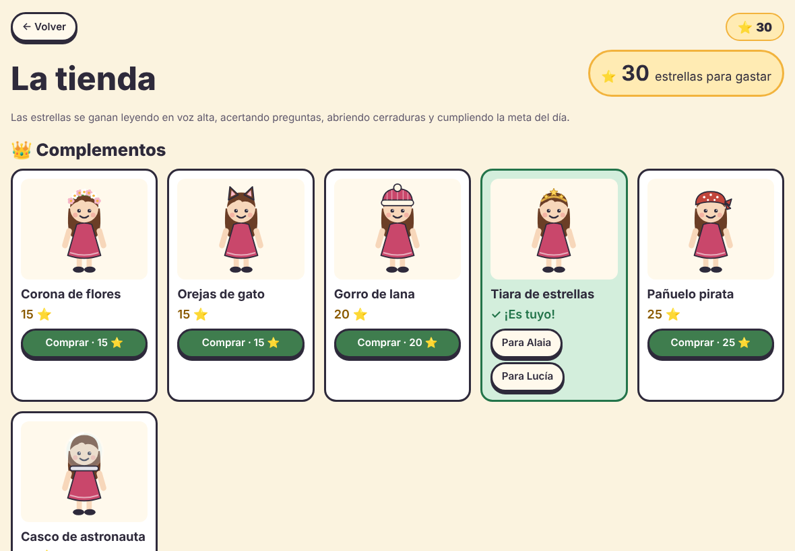

<div align="center">


# La biblioteca mágica

**Cuentos interactivos para aprender a leer jugando**<br>
pensados para niñas y niños con dislexia

[](https://serbenda.github.io/story-reader/)


[](https://github.com/serbenda/story-reader/actions/workflows/pages/pages-build-deployment)
[](https://github.com/serbenda/story-reader/actions/workflows/validar-cuentos.yml)



</div>

---

Alaia y su hermana Lucía resuelven pequeños misterios en mundos mágicos. Para avanzar hay que
**leer las pistas**, **leer frases en voz alta** (el juego escucha con el micrófono y colorea las
palabras bien leídas) y **elegir el camino correcto**. Como cada partida se sortea, **no se puede
jugar de memoria**: hay que leer de verdad.

<div align="center">

</div>

## 🎮 Cómo se juega

| Paso | Qué pasa |
|---|---|
| 📚 **Elige un libro** | Seis libros en la estantería, tres capítulos cada uno. Cada capítulo es un caso: algo o alguien se ha perdido. |
| 👀 **Lee la historia** | El texto aparece poco a poco, una idea por línea, para no agobiar. Tocar cualquier palabra la lee en voz alta. |
| 🎤 **Lee en voz alta** | Las palabras bien leídas se ponen en verde y solo hay que repetir las subrayadas. A la tercera se puede seguir sin castigo. |
| 🔒 **Abre la cerradura** | Retos cortos con las letras que se confunden (b/d, p/q, m/n/u) y con sílabas invertidas. |
| 🧭 **Elige el camino** | Las pistas dicen dónde está lo que se busca. Si te equivocas, pasa algo gracioso y vuelves a leer. |
| ✨ **Palabras mágicas** | Al empezar cada capítulo hay que leer tres palabras que costaron otras veces, hasta «conquistarlas». |
| 🎯 **Meta del día** | Un ratito de lectura cada día (5, 10 o 15 minutos, o un capítulo). Racha de días 🔥 y un cofre 🎁 si se cumple 5 días en la semana. |
| 🛍️ **Tienda** | Las estrellas ganadas se gastan en complementos, vestidos y mascotas nuevas. |
| 💎 **Tesoros de Lucía** | Hay cosas escondidas en los dibujos. Al tocarlas, Lucía las guarda en el álbum. |
| 🎨 **A tu manera** | Se eligen **los nombres** y si los cuentos son con **una niña o con dos hermanas** (por defecto, Alaia y Lucía). También su ropa y la mascota, que sale en todos los cuentos. |

## 📚 Los libros

<table>
<tr>
<td width="33%" valign="top"><br><b>🌲 El bosque de los susurros</b><br><sub>Una mariposa azul, una urraca coleccionista y una fiesta sorpresa tras la puerta del árbol viejo.</sub></td>
<td width="33%" valign="top"><br><b>🏝️ El secreto del faro</b><br><sub>La luz del faro se ha apagado: una gaviota misteriosa, un cristal dorado y una estrella de mar.</sub></td>
<td width="33%" valign="top"><br><b>🐄 La granja de los abuelos</b><br><sub>Un cerdito escapista, un pollito goloso y la tarta de la abuela en la fiesta del pueblo.</sub></td>
</tr>
<tr>
<td width="33%" valign="top"><br><b>🏰 El castillo de las nubes</b><br><sub>Una escalera de nubes, una reina con el vestido del revés y un dragón que estornuda flores.</sub></td>
<td width="33%" valign="top"><br><b>🚀 Viaje a la luna</b><br><sub>Un cohete en el jardín, un robot perdido en el planeta rojo y un dragoncito de estrellas.</sub></td>
<td width="33%" valign="top"><br><b>❄️ La montaña nevada</b><br><sub>Un pingüino perdido, un reno desaparecido y la carrera de las luces del norte.</sub></td>
</tr>
</table>

Los dibujos se generan con código y cambian un poco en cada partida, también de noche.

## 🌱 Cuatro niveles

| Nivel | Textos | Pistas | Preguntas |
|---|---|---|---|
| 🌱 **Aprendiz** | 3-5 frases cortas | directas: *«fue hacia el río»* | ¿A dónde fue? |
| 🌼 **Novatilla** | 4-6 frases | con trampa: *«primero fue al puente, pero luego…»* | de lugar |
| 📖 **Lectora** | 6-9 frases, palabras nuevas | hay que deducir: *«tenía las patas mojadas»* | de lugar y «¿por qué…?» |
| 🔎 **Superlectora** | textos largos | repartidas entre varios personajes y apuntadas en el **cuaderno de detective** | juntar pistas |

Al terminar un libro, el juego propone subir de nivel. El informe para mayores también recomienda cuándo hacerlo.

## 🧠 Pensado para la dislexia

- 🔤 Letra **Lexend** grande (tres tamaños), con letras y palabras espaciadas e interlineado amplio.
- 🟨 Fondo **crema** en vez de blanco y texto alineado a la izquierda.
- ✏️ **Una idea por línea**, con opción de **resaltar la línea** que se está leyendo.
- 🌈 **Sílabas de colores** (opcional): *ma·ri·po·sa* en dos colores alternos, con un separador de sílabas para el español.
- 🔊 **Escuchar por sílabas**: tocar una palabra la lee; tocarla otra vez la lee sílaba a sílaba mientras se iluminan.
- 📏 **Regla de lectura** (opcional): la línea que se lee destaca y las demás se atenúan.
- 👨‍👧 **Tu voz**: las palabras que le cuestan pueden sonar con la voz de papá o mamá en vez de la del robot.
- 🤝 **Ayuda sin castigo**: oír cualquier palabra, escuchar la frase después de intentarla, seguir tras tres intentos.
- 👂 **Reconocimiento tolerante**: acepta pequeñas diferencias, con tres niveles de exigencia.
- 🎯 **Práctica dirigida**: palabras mágicas con lo que cuesta y cerraduras con las confusiones típicas.
- 🎉 **Sin sonidos de error**. Se celebra el esfuerzo, no solo el acierto.

## 👨‍👩‍👧 Para mayores

En la pantalla de inicio, **mantén pulsado «⚙️ Mayores» dos segundos**.

<table>
<tr>
<td width="50%" valign="top"><br><sub>Informe de lectura (datos de ejemplo)</sub></td>
<td width="50%" valign="top">

**📊 Informe de lectura**
- Frases leídas y porcentaje a la primera, comparado con la semana anterior
- Preguntas y cerraduras acertadas a la primera, minutos de lectura
- Gráfico de los últimos 14 días
- **Palabras que le cuestan** (se pueden escuchar) y **palabras conquistadas**
- Últimas partidas, también las que dejó a medias
- **Recomendación de nivel** con botón para aplicarla
- **Copiar resumen** para su profe o logopeda

**⚙️ Ajustes**
- Nivel, tamaño de letra, exigencia del micro o jugar sin micro
- Sílabas de colores y regla de lectura
- **Meta de cada día** (5, 10 o 15 minutos, o un capítulo)
- **🎙️ Grabar tu voz** para las palabras difíciles (también desde el informe, junto a cada palabra). Se guardan solo en ese dispositivo
- **Voz** que lee las palabras y su **velocidad**
- **Pasar el progreso** entre tablet y portátil con un código (se juntan, no se borra nada)
- **💾 Copia de seguridad** en un archivo, para guardarla en Drive o iCloud y recuperarla

</td>
</tr>
</table>

## 📸 Capturas

| Estantería y meta del día | Lectura en voz alta | Cerradura mágica |
|---|---|---|
|  |  |  |

| Elegir protagonistas | Tienda |
|---|---|
|  |  |

## 📱 Instalarlo en la tablet

Se instala como una app, con su icono y a pantalla completa:

| Dispositivo | Cómo |
|---|---|
| **Android** (Chrome) | Abre la web → menú ⋮ → **Instalar aplicación** |
| **iPad** (Safari) | Abre la web → botón Compartir → **Añadir a pantalla de inicio** |

Después se puede jugar **sin internet**. El micrófono sí necesita conexión; sin ella, se usa el botón «¡Ya lo he leído!».

---

## 🛠️ Para desarrolladores y escritores de cuentos

<details>
<summary><b>🎤 Navegadores y micrófono</b></summary>

| Dispositivo | Navegador | Micrófono |
|---|---|---|
| Portátil | Chrome o Edge | ✅ |
| Tablet Android | Chrome | ✅ |
| iPad | Safari | ✅ |
| Cualquiera | Firefox | ❌ → modo «¡Ya lo he leído!» |

La primera vez el navegador pide permiso para usar el micro.
</details>

<details>
<summary><b>🔒 Privacidad</b></summary>

- No hay cuentas ni publicidad. Todo el progreso (partidas, palabras, estrellas, informe) se guarda **solo en el navegador** del dispositivo.
- Para saber cuánto se usa, se cuentan las **visitas y las partidas empezadas** con [GoatCounter](https://www.goatcounter.com/), sin cookies y sin datos personales: no se envía ningún nombre, texto leído, voz ni progreso. Si un bloqueador lo impide, el juego funciona igual.
- El juego pide al navegador que **no borre** esos datos. En iPad conviene **instalarlo en la pantalla de inicio**:
  si no, Safari puede borrar los datos de una web que no se abre en varias semanas.
- El reconocimiento de voz lo hace el propio navegador (en Chrome, a través de los servicios de Google).
- Los códigos para pasar el progreso solo contienen datos del juego.
- Las grabaciones de voz se guardan solo en el dispositivo donde se graban y no viajan en el código de progreso.
</details>

<details>
<summary><b>🚀 Publicar y desarrollar</b></summary>

**Ramas y paso a producción**

- `development`: donde se trabaja y se prueban los cambios.
- `main`: producción, lo que se publica en GitHub Pages. **Nada se sube directamente**: los cambios
  llegan solo por **pull request de `development` a `main`**, que se revisa antes de fusionar.

Antes de abrir el PR, comprueba los cuentos y juega las partidas de prueba:

```bash
python herramientas/validar.py todos   # cuentos: cientos de partidas al azar, con una y con dos niñas
python tests/partidas.py               # juego: partidas completas con micro simulado, tienda, meta, sílabas, copias…
```

Además, la GitHub Action **Comprobar cuentos** (`.github/workflows/validar-cuentos.yml`) hace las dos cosas sola en cada
PR a `main` y en cada subida a `development`. Para que un PR con cuentos rotos no se pueda fusionar:
*Settings → Branches → Add rule* para `main` → *Require status checks to pass* → **Validar los cuentos**.

**GitHub Pages:** *Settings → Pages → Deploy from a branch*, rama `main`, carpeta `/ (root)`. El archivo
`.nojekyll` es imprescindible: sin él, GitHub convierte los `.md` en páginas y el juego no encuentra los cuentos.

**Probar en el ordenador** (abrir `index.html` con doble clic no vale, hace falta un servidor):

```bash
python3 -m http.server 8000
# y abre http://localhost:8000
```

Si cambias archivos del juego, sube `VERSION` en `sw.js` para que las tablets instaladas descarguen la versión nueva.
</details>

<details>
<summary><b>✍️ Escribir cuentos nuevos</b></summary>

No hace falta tocar el código: un libro es una carpeta en `stories/` con archivos de texto.

1. Lee la **[guía de escritura](stories/GUIA-ESCRITURA.md)**: qué cambia en cada nivel y las reglas de gramática para que las piezas encajen.
2. Copia `stories/bosque-susurros/` con otro nombre y cambia el mundo y la historia.
3. Apunta el libro en `stories/index.json`:
   ```json
   { "id": "mi-libro", "carpeta": "mi-libro", "capitulos": ["cap-01.md", "cap-02.md", "cap-03.md"] }
   ```
4. **Compruébalo**:
   ```bash
   pip install playwright && python -m playwright install chromium   # solo la primera vez
   python herramientas/validar.py mi-libro             # o «todos»
   python herramientas/validar.py mi-libro --muestras  # además, enseña un ejemplo de cada escena
   ```
   Sortea cientos de partidas y avisa de variables sin rellenar, escenas sin pregunta o sin frase de voz,
   opciones mal marcadas, fondos que no existen, artículos mal unidos («a el») o frases demasiado largas.
</details>

<details>
<summary><b>📄 Formato de los cuentos</b></summary>

**libro.md** (el mundo del libro). Es una cabecera YAML entre `---`, con todas las frases entre comillas dobles:

| Campo | Para qué sirve |
|---|---|
| `titulo`, `resumen`, `portada` | Lo que se ve en la estantería (`portada` es un paisaje) |
| `lugares` | Sitios donde puede estar lo que se busca. Cada uno lleva `nombre`, `articulo` (el/la), `fondo`, `icono`, `pistas` y `senales` |
| `ayudantes` | Animales que dan pistas: `nombre`, `especie`, `articulo`, `emoji`, `descripcion`, `gracias` |
| `equivocado` / `equivocado_pregunta` | Lo que pasa al elegir mal el camino o fallar una pregunta |
| `tesoros` | Lo que Lucía encuentra en los dibujos (`emoji` y `nombre`) |

**cap-XX.md** (un capítulo):

```markdown
---
titulo: "La mariposa azul"
resumen: "Una mariposa azul cruza el jardín y {mascota} sale corriendo detrás de ella."
buscamos: mascota            # o { nombre: "la urraca Pepa", genero: f, emoji: "🐦" }
lugares: [rio, cueva, puente, prado]
pegatina: "🦋"
---

## pista                     ← una escena
@fondo: bosque               ← paisaje ($lugar = el sitio sorteado)
@con: ayudante               ← quién sale: mascota, ayudante, ayudante2, buscado
@noche                       ← (opcional) de noche

### aprendiz                 ← texto para este nivel
En el bosque está {ayudante}.
> {ayudante_nombre} dice que {mascota} fue {hacia_lugar}.
? ¿A dónde fue {mascota}?
---                          ← otra versión (sale una al azar)
Encima de una piedra está {ayudante}.
> «{mascota} fue {hacia_lugar}», dice {ayudante_nombre}.
? ¿A dónde tienen que ir Alaia y Lucía?

### lectora
? ¿Por qué {mascota} {pista1}?
* Porque había estado {en_lugar}.        ← correcta
- Porque había estado {en_falso}.        ← incorrectas (se barajan)
```

| Marca | Qué hace |
|---|---|
| `> frase` | Hay que leerla en voz alta para seguir |
| `? pregunta` | Pregunta. Sin opciones debajo, se elige entre tres lugares |
| `* opción` / `- opción` | Respuesta correcta / incorrecta |
| `[[texto]]` | Pista que se guarda en el cuaderno de detective |
| `@final` | Última escena del capítulo |
| `### todos` | Texto para cualquier nivel que no tenga el suyo |

Una escena sin texto para un nivel se salta en ese nivel.
</details>

<details>
<summary><b>🔣 Variables</b></summary>

| Variable | Ejemplo |
|---|---|
| `{lectora}` `{hermana}` · `{las_ninas}` | Alaia · Lucía · «Alaia y Lucía» o solo «Alaia» (los nombres se eligen al vestir) |
| `{{con dos niñas|con una}}` | Texto distinto si se juega con una sola niña. Ver la [guía](stories/GUIA-ESCRITURA.md) |
| `{mascota}` `{animal}` `{el_animal}` `{un_animal}` · `{mo}` | Luna · gatita · la gatita · una gatita · o/a |
| `{buscado}` · `{o}` | Quién se busca en el capítulo · o/a |
| `{lugar}` `{al_lugar}` `{del_lugar}` `{en_lugar}` `{hacia_lugar}` | El sitio correcto |
| `{falso}`, `{otro}` (con los mismos prefijos) | Dos sitios equivocados, para trampas |
| `{pista1}` `{pista2}` `{pista3}` `{pista_falsa}` | Pistas del sitio correcto y de uno falso |
| `{senal1}` `{senal2}` `{senal_falsa}` | Cómo es el sitio correcto y uno falso |
| `{ayudante}` `{al_ayudante}` `{del_ayudante}` `{ayudante_nombre}` `{ayudante_desc}` `{gracia}` | el búho Bruno · al búho Bruno · … |
| `{ayudante2}` … `{gracia2}` · `{o2}` | Un segundo ayudante · o/a del primero |

Una variable con mayúscula (`{Ayudante}`) se escribe con mayúscula. Las frases empiezan con mayúscula solas.
</details>

<details>
<summary><b>🎨 Paisajes disponibles</b></summary>

Se dibujan con código (`js/arte.js`), cambian un poco en cada partida y todos tienen versión de noche:

`casa` · `bosque` · `rio` · `cueva` · `puente` · `prado` · `arbol` · `playa` · `faro` · `barco` · `granja` ·
`huerto` · `castillo` · `torre` · `luna` · `planeta` · `nave` · `espacio` · `nieve` · `lago` · `iglu` · `cabana`

Para un paisaje nuevo, añade una función en `PAISAJES` dentro de `js/arte.js`. También se puede poner la ruta de una imagen (`fondo: imagenes/mi-dibujo.png`).
</details>

<details>
<summary><b>🗂️ Estructura del proyecto</b></summary>

```
index.html               página del juego
manifest.webmanifest     datos para instalarlo como app
sw.js                    modo sin internet
icono.svg, icono-*.png   iconos
css/estilos.css
js/
  datos.js               carga los libros de stories/
  texto.js               rellena las plantillas, separa los bloques y las sílabas
  voz.js                 reconocimiento de voz y lectura en voz alta
  grabaciones.js         la voz de la familia para las palabras difíciles
  arte.js                paisajes y personajes dibujados con código
  juego/                 el juego, en orden de carga:
    01-base.js           estado, registro, sonidos, palabras, variables y escenario
    02-portada.js        bienvenida, protagonistas, meta del día, tienda y estantería
    03-partida.js        escenas, cerraduras, lectura en voz alta, preguntas y final
    04-mayores.js        álbum, progreso, tu voz, ajustes e informe
    05-arranque.js       carga los libros y abre la primera pantalla
.github/workflows/       comprobación automática de los cuentos
stories/
  index.json             libros, mascotas y nombres de las protagonistas
  GUIA-ESCRITURA.md      cómo escribir un cuento
  <libro>/libro.md       el mundo de cada libro
  <libro>/cap-XX.md      los capítulos
herramientas/validar.py  comprobador de cuentos
tests/partidas.py        pruebas: partidas completas con micro simulado y funciones
docs/                    imágenes del README
```
</details>

---

<div align="center">
<sub>Hecho con cariño para Alaia y Lucía 💛 · Que cada cuento sea una excusa para leer un poquito más.</sub>
</div>
