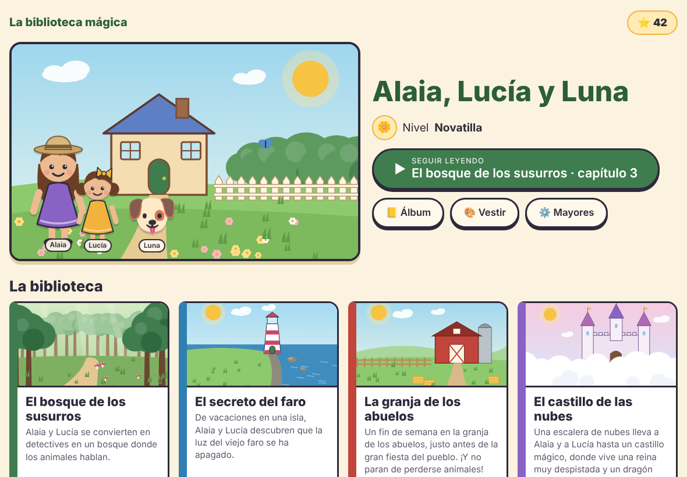
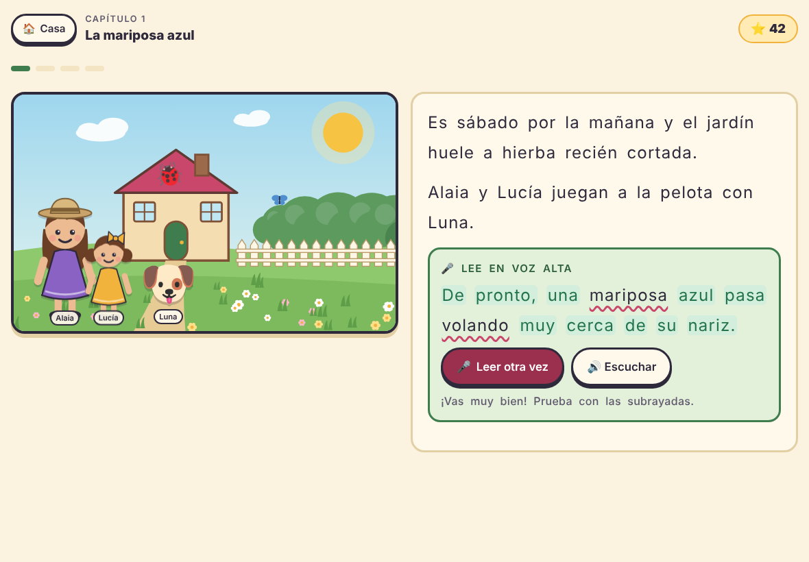
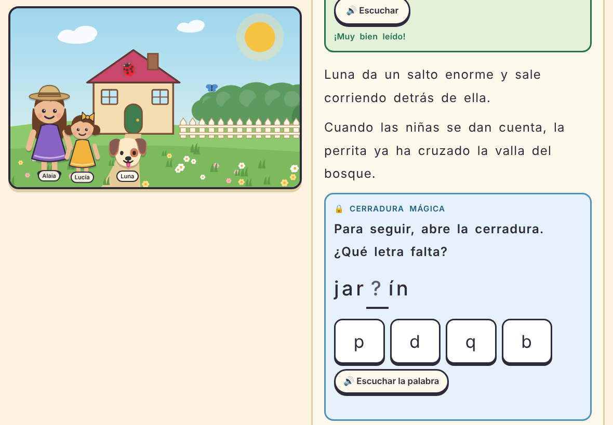
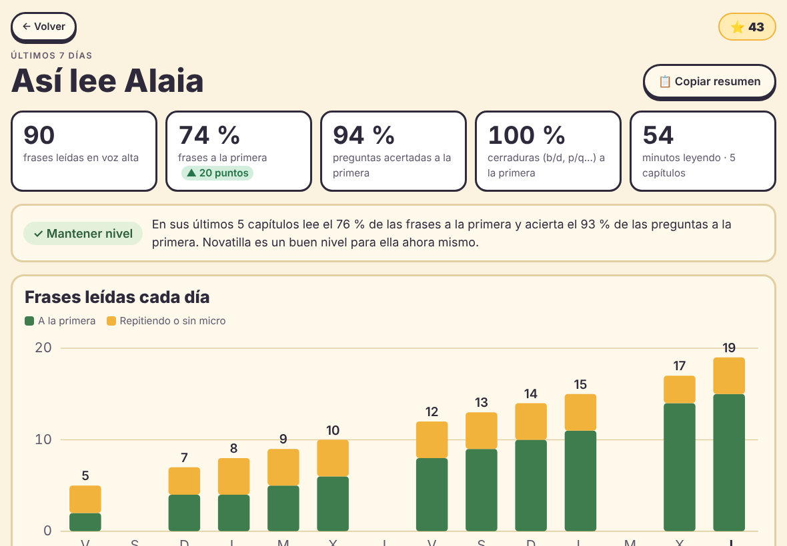

# 📚 La biblioteca mágica

Cuentos interactivos para aprender a leer jugando, pensados para niñas y niños con **dislexia**.
Alaia y su hermana Lucía resuelven pequeños misterios: para avanzar hay que **leer las pistas**,
**leer frases en voz alta** (el juego escucha con el micrófono) y **elegir el camino correcto**.

**▶ Jugar:** <https://serbenda.github.io/story-reader/>

| Estantería | Lectura en voz alta | Cerradura mágica | Informe para mayores |
|---|---|---|---|
|  |  |  |  |

---

## Índice

- [Cómo se juega](#cómo-se-juega)
- [Los libros](#los-libros)
- [Niveles](#niveles)
- [Pensado para la dislexia](#pensado-para-la-dislexia)
- [Para mayores](#para-mayores)
- [Instalarlo en la tablet](#instalarlo-en-la-tablet)
- [Navegadores y micrófono](#navegadores-y-micrófono)
- [Privacidad](#privacidad)
- [Publicar y desarrollar](#publicar-y-desarrollar)
- [Escribir cuentos nuevos](#escribir-cuentos-nuevos)
- [Estructura del proyecto](#estructura-del-proyecto)

---

## Cómo se juega

1. **Elige un libro** de la estantería y un capítulo. Cada capítulo es un caso: algo o alguien se ha perdido.
2. **Lee** el texto. Se va mostrando poco a poco, para no agobiar.
3. **🎤 Lee en voz alta** las frases del recuadro verde. Las palabras bien leídas se ponen en verde y
   solo hay que repetir las subrayadas. Si cuesta mucho, a la tercera se puede seguir sin castigo.
4. **🔒 Abre las cerraduras mágicas**: retos cortos de letras que se confunden (b/d, p/q, m/n/u) y
   de palabras bien escritas frente a sílabas invertidas.
5. **Elige el camino**. Si te equivocas, pasa algo gracioso y vuelves a leer la pista.
6. **✨ Palabras mágicas**: al empezar cada capítulo, el juego pide leer tres palabras que le han
   costado en partidas anteriores, hasta que las «conquista».

Además:

- **Cada partida es distinta.** El lugar correcto, el animal que ayuda, las pistas y las versiones del
  texto se sortean, así que no se puede jugar de memoria.
- **Tocar cualquier palabra la lee en voz alta.** Tocar a un personaje hace que salude.
- **Lucía encuentra tesoros** escondidos en los dibujos (hay que tocarlos), que van al álbum.
- **Álbum** con pegatinas de cada capítulo, amigos de los cuentos y tesoros.
- **Personaliza** a las protagonistas (piel, pelo, ropa, complemento) y elige mascota y su nombre:
  la mascota sale en los cuentos.

## Los libros

| Libro | Mundo | De qué va |
|---|---|---|
| 🌲 **El bosque de los susurros** | bosque, río, cueva, puente, prado | Una mariposa azul, una urraca que colecciona cosas brillantes y una fiesta sorpresa tras la puerta del árbol viejo. |
| 🏝️ **El secreto del faro** | playa, faro, barco, cueva | La luz del faro se ha apagado. ¿Qué tiene que ver la gaviota del pañuelo rojo? |
| 🐄 **La granja de los abuelos** | granero, huerto, prado, estanque | Un fin de semana en la granja con animales escapistas antes de la gran fiesta del pueblo. |
| 🏰 **El castillo de las nubes** | castillo, torre, cueva, puente, jardín | Una escalera de nubes, una reina despistada y un dragón que estornuda flores. |
| 🚀 **Viaje a la luna** | cohete, Luna, planeta rojo, espacio | Un cohete aterriza en el jardín: un robot y un extraterrestre necesitan ayuda. |
| ❄️ **La montaña nevada** | pistas, lago helado, iglú, cabaña | Un pingüino perdido, un reno desaparecido y la carrera de las luces del norte. |

Cada libro tiene 3 capítulos, y cada capítulo, textos distintos para los 4 niveles.

## Niveles

| Nivel | Textos | Pistas | Preguntas |
|---|---|---|---|
| 🌱 **Aprendiz** | 3-5 frases cortas | directas: «fue hacia el río» | ¿A dónde fue? |
| 🌼 **Novatilla** | 4-6 frases | con trampa: «primero fue al puente, pero luego…» | de lugar |
| 📖 **Lectora** | 6-9 frases, palabras nuevas | hay que deducir: «tenía las patas mojadas» | de lugar y «¿por qué…?» |
| 🔎 **Superlectora** | textos largos | repartidas entre varios personajes, se apuntan en el **cuaderno de detective** | juntar pistas |

Al terminar un libro, el juego propone subir de nivel. Desde el menú para mayores se puede cambiar
cuando se quiera, y el informe recomienda cuándo hacerlo.

## Pensado para la dislexia

- Letra **Lexend** grande (tres tamaños), con letras y palabras espaciadas e interlineado amplio.
- Fondo **crema** en vez de blanco y texto alineado a la izquierda, nunca justificado.
- **Una idea por línea**; opción de **resaltar la línea** que se está leyendo.
- **Ayuda sin castigo**: oír cualquier palabra, escuchar la frase después de intentarla, seguir tras tres intentos.
- **Reconocimiento tolerante**: compara palabra a palabra y acepta pequeñas diferencias (tres niveles de exigencia).
- **Práctica dirigida**: palabras mágicas con lo que le cuesta y cerraduras con las confusiones típicas.
- **Sin sonidos de error** y con celebraciones del esfuerzo, no solo del acierto.

## Para mayores

En la pantalla de inicio, **mantén pulsado «⚙️ Mayores» dos segundos**. Ahí puedes:

- Cambiar el **nivel**, el **tamaño de letra**, cuánto **perdona el micro** o jugar **sin micro**.
- Elegir la **voz** que lee las palabras y su **velocidad** (cada dispositivo tiene voces distintas;
  las «naturales» o «mejoradas» suenan mucho mejor).
- **📊 Ver el informe de lectura**:
  - frases leídas, porcentaje a la primera (comparado con la semana anterior), preguntas y cerraduras acertadas a la primera, minutos;
  - gráfico de los últimos 14 días;
  - **palabras que le cuestan** (se pueden escuchar) y **palabras conquistadas**;
  - últimas partidas, incluidas las que dejó a medias;
  - **recomendación de nivel** con botón para aplicarla;
  - **copiar resumen** para mandárselo a su profesora o logopeda.
- **Pasar el progreso a otro dispositivo**: copia el código en uno y pégalo en el otro. Se juntan los
  dos progresos (no se borra nada).
- Borrar el progreso (la ropa y la mascota se mantienen).

## Instalarlo en la tablet

Se puede instalar como una app, con su icono y a pantalla completa:

- **Android (Chrome):** abre la web → menú ⋮ → **Instalar aplicación** (o «Añadir a pantalla de inicio»).
- **iPad (Safari):** abre la web → botón Compartir → **Añadir a pantalla de inicio**.

Una vez abierto, los cuentos quedan guardados y se puede jugar **sin internet**. El micrófono sí
necesita conexión; sin ella, se usa el botón «¡Ya lo he leído!».

## Navegadores y micrófono

| Dispositivo | Navegador | Micrófono |
|---|---|---|
| Portátil | Chrome o Edge | ✅ |
| Tablet Android | Chrome | ✅ |
| iPad | Safari | ✅ |
| Cualquiera | Firefox | ❌ → modo «¡Ya lo he leído!» |

La primera vez el navegador pide permiso para usar el micro.

## Privacidad

- No hay cuentas, servidores ni publicidad. Todo el progreso se guarda **solo en el navegador** del dispositivo.
- El reconocimiento de voz lo hace el propio navegador (en Chrome, a través de los servicios de Google).
- Los códigos para pasar el progreso solo contienen datos del juego.

## Publicar y desarrollar

**Ramas y paso a producción**

- `development`: donde se trabaja y se prueban los cambios.
- `main`: producción, lo que se publica en GitHub Pages. **No se sube nada directamente**: los
  cambios llegan solo por **pull request de `development` a `main`**, que se revisa antes de fusionar.

Antes de abrir el PR, comprueba los cuentos con `python herramientas/validar.py todos`.

**GitHub Pages:** *Settings → Pages → Deploy from a branch*, rama `main`, carpeta `/ (root)`.
El archivo `.nojekyll` es imprescindible: sin él, GitHub convierte los `.md` en páginas y el juego no
encuentra los cuentos.

**Probar en el ordenador** (abrir `index.html` con doble clic no vale, hace falta un servidor):

```bash
python3 -m http.server 8000
# y abre http://localhost:8000
```

Si cambias archivos del juego, sube `VERSION` en `sw.js` para que las tablets instaladas descarguen la versión nueva.

## Escribir cuentos nuevos

No hace falta tocar el código: un libro es una carpeta en `stories/` con archivos de texto.

1. Lee la **[guía de escritura](stories/GUIA-ESCRITURA.md)**: qué cambia en cada nivel y las reglas de gramática para que las piezas encajen.
2. Copia `stories/bosque-susurros/` con otro nombre y cambia el mundo y la historia.
3. Apunta el libro en `stories/index.json`:
   ```json
   { "id": "mi-libro", "carpeta": "mi-libro", "capitulos": ["cap-01.md", "cap-02.md", "cap-03.md"] }
   ```
4. **Compruébalo**:
   ```bash
   pip install playwright && python -m playwright install chromium   # solo la primera vez
   python herramientas/validar.py mi-libro             # o «todos»
   python herramientas/validar.py mi-libro --muestras  # además, enseña un ejemplo de cada escena
   ```
   Sortea cientos de partidas y avisa de variables sin rellenar, escenas sin pregunta o sin frase de
   voz, opciones mal marcadas, fondos que no existen o frases demasiado largas.

### libro.md: el mundo del libro

Cabecera YAML (entre `---`) con todas las frases entre comillas dobles:

| Campo | Para qué sirve |
|---|---|
| `titulo`, `resumen`, `portada` | Lo que se ve en la estantería (`portada` es un paisaje) |
| `lugares` | Sitios donde puede estar lo que se busca. Cada uno: `nombre`, `articulo` (el/la), `fondo`, `icono`, `pistas` y `senales` |
| `ayudantes` | Animales que dan pistas: `nombre`, `especie`, `articulo`, `emoji`, `descripcion`, `gracias` |
| `equivocado` | Lo que pasa al elegir mal el camino |
| `equivocado_pregunta` | Ánimo al fallar una pregunta |
| `tesoros` | Lo que Lucía encuentra en los dibujos (`emoji` y `nombre`) |

### cap-XX.md: un capítulo

```markdown
---
titulo: "La mariposa azul"
resumen: "Una mariposa azul cruza el jardín y {mascota} sale corriendo detrás de ella."
buscamos: mascota            # o { nombre: "la urraca Pepa", genero: f, emoji: "🐦" }
lugares: [rio, cueva, puente, prado]
pegatina: "🦋"
---

## pista                     ← una escena
@fondo: bosque               ← paisaje ($lugar = el sitio sorteado)
@con: ayudante               ← quién sale: mascota, ayudante, ayudante2, buscado
@noche                       ← (opcional) de noche

### aprendiz                 ← texto para este nivel
En el bosque está {ayudante}.
> {ayudante_nombre} dice que {mascota} fue {hacia_lugar}.
? ¿A dónde fue {mascota}?
---                          ← otra versión (sale una al azar)
Encima de una piedra está {ayudante}.
> «{mascota} fue {hacia_lugar}», dice {ayudante_nombre}.
? ¿A dónde tienen que ir Alaia y Lucía?

### lectora
? ¿Por qué {mascota} {pista1}?
* Porque había estado {en_lugar}.        ← correcta
- Porque había estado {en_falso}.        ← incorrectas (se barajan)
```

| Marca | Qué hace |
|---|---|
| `> frase` | Hay que leerla en voz alta para seguir |
| `? pregunta` | Pregunta. Sin opciones debajo, se elige entre tres lugares |
| `* opción` / `- opción` | Respuesta correcta / incorrecta |
| `[[texto]]` | Pista que se guarda en el cuaderno de detective |
| `@final` | Última escena del capítulo |
| `### todos` | Texto para cualquier nivel que no tenga el suyo |

Una escena sin texto para un nivel se salta en ese nivel.

### Variables

| Variable | Ejemplo |
|---|---|
| `{mascota}` `{animal}` `{el_animal}` `{un_animal}` · `{mo}` | Luna · gatita · la gatita · una gatita · o/a |
| `{buscado}` · `{o}` | quién se busca en el capítulo · o/a |
| `{lugar}` `{al_lugar}` `{del_lugar}` `{en_lugar}` `{hacia_lugar}` | el sitio correcto |
| `{falso}`, `{otro}` (con los mismos prefijos) | dos sitios equivocados, para trampas |
| `{pista1}` `{pista2}` `{pista3}` `{pista_falsa}` | pistas del sitio correcto y de uno falso |
| `{senal1}` `{senal2}` `{senal_falsa}` | cómo es el sitio correcto y uno falso |
| `{ayudante}` `{al_ayudante}` `{del_ayudante}` `{ayudante_nombre}` `{ayudante_desc}` `{gracia}` | el búho Bruno · al búho Bruno · … |
| `{ayudante2}` … `{gracia2}` | un segundo ayudante · `{o2}`: o/a del primero |

Una variable con mayúscula (`{Ayudante}`) se escribe con mayúscula. Las frases empiezan con mayúscula solas.

### Paisajes disponibles

Se dibujan con código (`js/arte.js`) y cambian un poco en cada partida. Todos tienen versión de noche.

`casa` · `bosque` · `rio` · `cueva` · `puente` · `prado` · `arbol` · `playa` · `faro` · `barco` ·
`granja` · `huerto` · `castillo` · `torre` · `luna` · `planeta` · `nave` · `espacio` · `nieve` · `lago` · `iglu` · `cabana`

Para un paisaje nuevo, añade una función en `PAISAJES` dentro de `js/arte.js`. También se puede poner
la ruta de una imagen (`fondo: imagenes/mi-dibujo.png`).

## Estructura del proyecto

```
index.html               página del juego
manifest.webmanifest     datos para instalarlo como app
sw.js                    modo sin internet
icono.svg, icono-*.png   iconos
css/estilos.css
js/
  datos.js               carga los libros de stories/
  texto.js               rellena las plantillas y separa los bloques
  voz.js                 reconocimiento de voz y lectura en voz alta
  arte.js                paisajes y personajes dibujados con código
  juego.js               pantallas, partida, niveles, minijuegos, álbum, informe y ajustes
stories/
  index.json             libros, mascotas y nombres de las protagonistas
  GUIA-ESCRITURA.md      cómo escribir un cuento
  <libro>/libro.md       el mundo de cada libro
  <libro>/cap-XX.md      los capítulos
herramientas/validar.py  comprobador de cuentos
docs/capturas/           imágenes del README
```
