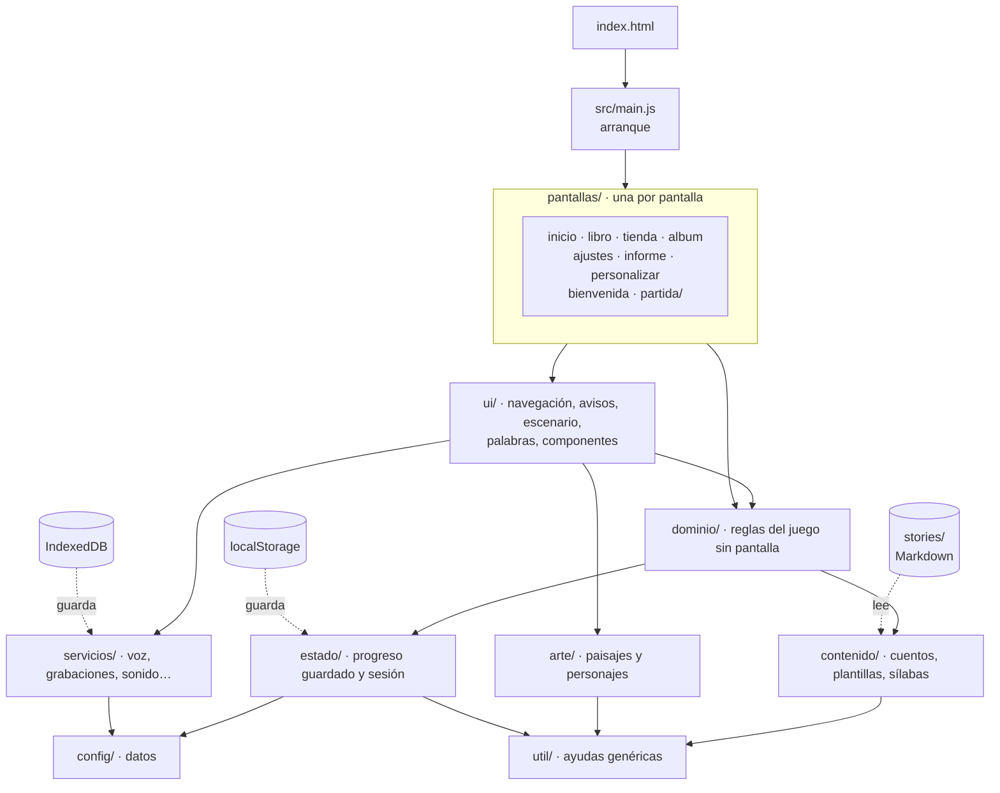
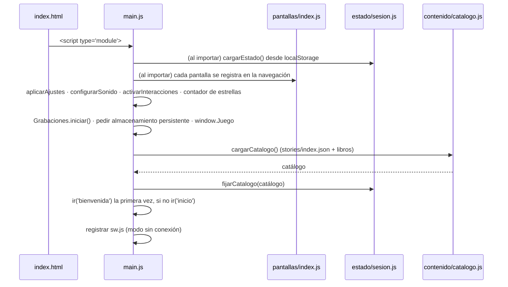
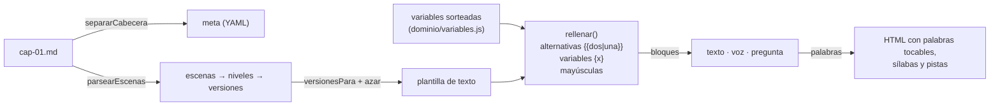
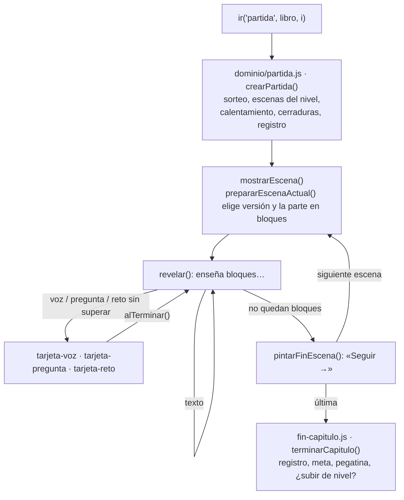

# Arquitectura de La biblioteca mágica

Este documento explica **cómo está hecho el juego por dentro**: las piezas, las reglas que las separan,
cómo fluye la información y dónde tocar para ampliarlo. Para el día a día (ramas, PR, recetas paso a
paso) mira **[CONTRIBUTING.md](../CONTRIBUTING.md)**; para el porqué de cada decisión,
**[DECISIONES.md](DECISIONES.md)**; para escribir cuentos, la **[guía de escritura](../stories/GUIA-ESCRITURA.md)**.

## Índice

1. [Principios](#1-principios)
2. [Vista general](#2-vista-general)
3. [Las capas](#3-las-capas)
4. [El arranque](#4-el-arranque)
5. [El estado](#5-el-estado)
6. [Navegación entre pantallas](#6-navegación-entre-pantallas)
7. [Eventos](#7-eventos)
8. [Del Markdown a la pantalla](#8-del-markdown-a-la-pantalla)
9. [Una partida por dentro](#9-una-partida-por-dentro)
10. [El arte](#10-el-arte)
11. [Los estilos](#11-los-estilos)
12. [Sin conexión](#12-sin-conexión)
13. [Calidad: pruebas y vigilancia](#13-calidad-pruebas-y-vigilancia)
14. [Catálogo de módulos](#14-catálogo-de-módulos)
15. [Glosario](#15-glosario)

---

## 1. Principios

| Principio | Qué significa en la práctica |
|---|---|
| **Sin paso de compilación** | Lo que hay en el repositorio es lo que sirve GitHub Pages. Módulos ES nativos (`<script type="module">`), sin bundler, sin `npm install`. |
| **Una responsabilidad por archivo** | Archivos pequeños (casi todos por debajo de 150 líneas) que hacen una sola cosa y lo dicen en su primera línea (`@file`). |
| **Capas con dependencias en un solo sentido** | Lo de abajo (datos, utilidades) no sabe nada de lo de arriba (pantallas). Lo vigila `herramientas/arquitectura.js` en cada PR. |
| **La lógica no toca el DOM** | Las reglas del juego (`src/dominio/`) calculan y guardan; las pantallas pintan. Así la lógica se entiende y se prueba sola. |
| **Contenido fuera del código** | Los cuentos son Markdown en `stories/`; los premios, niveles y la tienda, datos en `src/config/`. Cambiarlos no exige tocar lógica. |
| **Todo en español** | Nombres de archivos, funciones, variables y comentarios. Es un proyecto para una familia española y quien lo amplíe debe entenderlo sin traducir. |
| **Pensado para la dislexia** | Letra Lexend grande, fondo crema, sílabas de colores, sin sonidos de error, nunca un «¡mal!». Ver [la sección del README](../README.md#-pensado-para-la-dislexia). |
| **Privacidad** | Nada sale del dispositivo salvo el recuento anónimo de visitas. Sin cuentas, sin cookies. |

## 2. Vista general



## 3. Las capas

Cada carpeta de `src/` es una capa. Una capa solo puede importar de las que tiene a su derecha
en esta tabla (y de sí misma). Las reglas están escritas en `CAPAS` dentro de
[`herramientas/arquitectura.js`](../herramientas/arquitectura.js), que falla si alguien se las salta.

| Capa | Responsabilidad | Puede importar de |
|---|---|---|
| `config/` | Datos fijos: niveles, tolerancias, premios, tienda, apariencia, frases de ánimo. | — |
| `util/` | Ayudas genéricas que no saben que esto es un juego: DOM, azar, fechas, números, eventos, base64. | — |
| `contenido/` | Leer y transformar cuentos: catálogo, escenas, plantillas, bloques, sílabas. Solo texto. | util |
| `servicios/` | Hablar con el navegador: reconocimiento y síntesis de voz, grabaciones, sonido, contador de visitas, plataforma. | util, config |
| `arte/` | Dibujos SVG generados con código: paisajes por mundos, piezas, personajes. | util |
| `estado/` | La forma del progreso, cómo se guarda y la sesión (progreso, catálogo y partida en curso). | config, util |
| `dominio/` | Las reglas del juego: partida, variables, repaso, cerraduras, meta diaria, progreso, tienda, informe, transferencia. **Sin DOM.** | estado, contenido, config, util |
| `ui/` | Piezas de interfaz reutilizables: navegación, avisos, capas, palabras tocables, escenario, cabecera, componentes. | dominio, estado, contenido, servicios, arte, config, util |
| `pantallas/` | Una pantalla por archivo. **No se importan entre sí**: navegan con `ir()`. La partida es una carpeta con sus tarjetas. | ui, dominio, estado, contenido, servicios, arte, config, util |
| raíz (`main.js`, `depuracion.js`) | Arranque y puerta para las pruebas. | todo |

Otras reglas que también vigila la herramienta: no hay **dependencias circulares**, cada archivo empieza
con un comentario **`@file`**, cada exportación tiene **JSDoc** encima y cada hoja de estilo está enlazada
desde el índice.

## 4. El arranque

`index.html` carga `js-yaml` (script clásico, deja `window.jsyaml`) y después `src/main.js` como módulo.
Los módulos se ejecutan cuando el HTML ya está listo, así que `document.getElementById('app')` funciona
al importar.



Si un libro tiene un error, se salta y se avisa en la consola; si no se carga ninguno, se explica en
pantalla.

## 5. El estado

Hay **un único estado global mutable**, y vive en [`src/estado/sesion.js`](../src/estado/sesion.js):

| Variable | Qué es | Quién la cambia |
|---|---|---|
| `estado` | Todo el progreso de la niña (tipo `Estado` en `almacen.js`). Se guarda en localStorage. | Se modifica por dentro desde dominio y pantallas; solo `reemplazarEstado()` lo sustituye entero (al borrar). |
| `catalogo` | Libros, mascotas y nombres por defecto. | `fijarCatalogo()` al arrancar. |
| `partida` | El capítulo que se está jugando, o `null`. | `fijarPartida()` al empezar un capítulo y al volver a casa. |

Son *live bindings* de los módulos ES: quien hace `import { estado } from '…/sesion.js'` ve siempre el
objeto actual, pero **no puede reasignarlo**; para eso están las funciones `fijar…`/`reemplazar…`. Así
cualquier cambio de «qué objeto es el estado» se localiza en un solo sitio.

**Guardar** es explícito: `guardar()` escribe todo el estado en localStorage. Las funciones del dominio
que modifican sin guardar lo dicen en su JSDoc («No guarda»), y guarda quien las llama, una vez.

**Compatibilidad hacia atrás**: `estadoInicial()` en [`almacen.js`](../src/estado/almacen.js) es la fuente
de verdad de los campos. Al cargar un guardado antiguo, lo que falte se completa con esos valores. Por eso
un campo nuevo **siempre** necesita valor por defecto ahí. Los nombres `perfil.alaya` y `perfil.lucia`
(aspecto de la que lee y de la hermana) son históricos y se mantienen para no romper progresos guardados.

**Qué se guarda dónde:**

| Dato | Dónde | Sale del dispositivo |
|---|---|---|
| Progreso, ajustes, registro, palabras | localStorage `biblioteca-magica-v1` | Solo si los mayores hacen copia o pasan el código |
| Voz de la familia | IndexedDB `biblioteca-voces` | Nunca |
| Juego y cuentos para jugar sin internet | Cache Storage (service worker) | — |

## 6. Navegación entre pantallas

[`src/ui/navegacion.js`](../src/ui/navegacion.js) es un registro de pantallas por nombre:

```js
// src/pantallas/tienda.js
registrarPantalla('tienda', pantallaTienda);

// en cualquier otra pantalla
$('#tienda').onclick = irA('tienda');        // atajo para botones
ir('partida', libro, capIndex);              // con argumentos
```

Una pantalla pinta en `app` (el `<main id="app">`) y conecta sus eventos. Como las pantallas no se
importan entre sí, no hay ciclos y cada una se entiende sola. `src/pantallas/index.js` las importa todas
para que se registren.

| Pantalla | Argumentos | Llega desde |
|---|---|---|
| `bienvenida` | — | arranque (sin perfil) |
| `personalizar` | `{ primeraVez }` | bienvenida, inicio («Vestir») |
| `inicio` | — | arranque, casi todas |
| `libro` | `libro` | inicio |
| `partida` | `libro, capIndex` | inicio («Seguir leyendo»), libro, fin de capítulo |
| `tienda` | — | inicio |
| `album` | — | inicio |
| `ajustes` | — | inicio (manteniendo pulsado «Mayores»), informe |
| `informe` | — | ajustes |

## 7. Eventos

[`src/util/eventos.js`](../src/util/eventos.js) es un bus mínimo (`escuchar` / `emitir`) para que el
dominio avise sin conocer la interfaz:

| Evento | Datos | Lo emite | Lo escucha |
|---|---|---|---|
| `estrellas-cambiadas` | `{ saldo }` | `dominio/estrellas.js` al ganar o gastar | `ui/cabecera.js` (anima el contador) |

Los toques que funcionan en cualquier pantalla (palabras, líneas, personajes, tesoros) usan **delegación
de eventos** sobre `document` y se activan una vez en el arranque
([`ui/interacciones.js`](../src/ui/interacciones.js)).

## 8. Del Markdown a la pantalla



- **Formato de los cuentos**: [README](../README.md#️-para-desarrolladores-y-escritores-de-cuentos) y
  [guía de escritura](../stories/GUIA-ESCRITURA.md).
- **Variables**: se sortean por partida en [`dominio/variables.js`](../src/dominio/variables.js)
  (lugares, ayudantes, pistas, señales…), así la historia cambia y no se puede resolver de memoria.
- **Una o dos niñas**: `{{con dos|con una}}` se resuelve antes y después de las variables, porque las
  piezas de `libro.md` también pueden llevarlas.

## 9. Una partida por dentro



- Cada **tarjeta** recibe su bloque y una función `alTerminar`; guarda su progreso dentro del propio
  bloque (`superado`, `resuelta`, `resuelto`). Añadir un tipo de bloque nuevo es crear su tarjeta y
  añadirla a `TARJETAS` en [`pantallas/partida/index.js`](../src/pantallas/partida/index.js).
- **Registro de lectura** ([`dominio/registro-lectura.js`](../src/dominio/registro-lectura.js)): cada
  partida suma frases, intentos, preguntas y cerraduras (a la primera o no) y el tiempo por escena (como
  máximo 10 minutos por escena). Las palabras solo cuentan en el **primer intento**, y los nombres propios
  nunca.
- **Meta diaria** ([`dominio/meta-diaria.js`](../src/dominio/meta-diaria.js)): se comprueba al cambiar de
  escena, al salir y al terminar; premia una sola vez al día.

## 10. El arte

Todo se dibuja con SVG generado por código ([`src/arte/`](../src/arte)): sin archivos de imagen, pesa poco
y cambia en cada partida.

- **Azar repetible** ([`aleatorio.js`](../src/arte/aleatorio.js)): con la misma semilla sale el mismo
  dibujo; cada partida estrena semilla.
- **Paisajes por mundos** (`paisajes/hogar.js`, `bosque.js`, `mar.js`…) con la firma común
  `(r, noche, defs) → string`, registrados en [`paisajes/index.js`](../src/arte/paisajes/index.js).
- **Piezas** reutilizables (árboles, nubes, flores…) en [`piezas.js`](../src/arte/piezas.js) y cielo,
  sol, luna y velo de noche en [`cielo.js`](../src/arte/cielo.js).
- **Personajes**: [`personajes/nina.js`](../src/arte/personajes/nina.js) con complementos y estampados en
  archivos propios. Mascotas, ayudantes y tesoros son emoji (con la fuente de color de cada sistema).
- Los `id` de los degradados y patrones se generan con `nuevoId()` para que no choquen entre dibujos.

## 11. Los estilos

[`css/estilos.css`](../css/estilos.css) es solo un índice de `@import` en orden de cascada:

| Carpeta | Contenido |
|---|---|
| `css/base/` | `variables.css` (colores, fuentes, radios), `documento.css` (base y tipografía), y al final `lectura-accesible.css` (sílabas de colores, regla) y `adaptable.css` (móvil y menos movimiento). |
| `css/componentes/` | Piezas usadas en varias pantallas: botones, opciones, cabecera, escenario, tarjetas, capas, meta, avisos… |
| `css/pantallas/` | Lo propio de cada pantalla. |

La primera línea de cada hoja dice qué módulo de `src/` pinta ese HTML. Los ajustes de los mayores se
aplican con clases en `<body>` (`con-silabas`, `con-regla`, `con-resaltado`) y la variable
`--tam-lectura` ([`ui/ajustes-visuales.js`](../src/ui/ajustes-visuales.js)), sin redibujar.

## 12. Sin conexión

[`sw.js`](../sw.js) guarda todo el juego y los cuentos («primero lo guardado, por detrás se actualiza»).
Su lista `RECURSOS` y su `VERSION` **se generan** con `npm run preparar`
([`herramientas/recursos-sin-conexion.js`](../herramientas/recursos-sin-conexion.js)); la versión es un
resumen del contenido, así que cualquier cambio llega a las tablets instaladas. La CI falla si la lista no
está al día.

## 13. Calidad: pruebas y vigilancia

| Nivel | Qué comprueba | Cómo | Tiempo |
|---|---|---|---|
| Arquitectura | Importaciones reales, capas, ciclos, `@file`, JSDoc en cada exportación, CSS enlazado y equilibrado | `node herramientas/arquitectura.js` | < 1 s |
| Sin conexión | Lista y versión de `sw.js` al día | `node herramientas/recursos-sin-conexion.js --comprobar` | < 1 s |
| Unitarias | Plantillas, alternativas, bloques, escenas, sílabas, comparación de voz, utilidades, arte, coherencia de la configuración | `node --test "tests/unidad/*.test.js"` | < 1 s |
| Cuentos | Cientos de partidas al azar por libro, con una y con dos niñas: variables sin rellenar, artículos mal unidos, escenas sin voz o sin pregunta, fondos inexistentes… | `python herramientas/validar.py todos` | ~ 1 min |
| Extremo a extremo | Partidas completas en Chromium con micro simulado, tienda, meta, sílabas, grabación, copias, código de progreso, informe | `python tests/partidas.py` | ~ 2 min |

Todo se ejecuta en cada PR ([`.github/workflows/validar-cuentos.yml`](../.github/workflows/validar-cuentos.yml))
y `main` no admite fusionar si falla. Las pruebas en navegador usan `window.Juego`
([`src/depuracion.js`](../src/depuracion.js)), la única puerta al estado desde fuera.

## 14. Catálogo de módulos

Generado a partir del comentario `@file` de cada archivo. `herramientas/arquitectura.js` comprueba que
cada módulo de `src/` aparece aquí.

#### raiz

| Módulo | Qué hace |
|---|---|
| [`depuracion.js`](../src/depuracion.js) | `window.Juego`: puerta de entrada para las pruebas automáticas y la consola. |
| [`main.js`](../src/main.js) | Punto de entrada: prepara los servicios, carga los libros y abre la primera pantalla. |

#### config

| Módulo | Qué hace |
|---|---|
| [`config/apariencia.js`](../src/config/apariencia.js) | Opciones para vestir a las protagonistas y elegir mascota. |
| [`config/index.js`](../src/config/index.js) | Punto único de acceso a la configuración. |
| [`config/mensajes.js`](../src/config/mensajes.js) | Frases de ánimo que dice el juego. |
| [`config/niveles.js`](../src/config/niveles.js) | Niveles de lectura y exigencia del micrófono. |
| [`config/recompensas.js`](../src/config/recompensas.js) | Estrellas que se ganan, meta diaria y límites del registro. |
| [`config/tienda.js`](../src/config/tienda.js) | Lo que se compra con estrellas. |

#### util

| Módulo | Qué hace |
|---|---|
| [`util/azar.js`](../src/util/azar.js) | Azar: elegir y barajar. |
| [`util/base64.js`](../src/util/base64.js) | Bytes ⇄ base64 y compresión gzip con las APIs del navegador. |
| [`util/dom.js`](../src/util/dom.js) | Ayudas pequeñas para trabajar con el DOM. |
| [`util/eventos.js`](../src/util/eventos.js) | Bus de eventos mínimo (publicar / suscribirse). |
| [`util/fechas.js`](../src/util/fechas.js) | Fechas en hora local: días, semanas y formatos cortos en español. |
| [`util/numeros.js`](../src/util/numeros.js) | Cuentas pequeñas. |

#### contenido

| Módulo | Qué hace |
|---|---|
| [`contenido/bloques.js`](../src/contenido/bloques.js) | Parte el texto de una escena (ya rellenado) en bloques. |
| [`contenido/catalogo.js`](../src/contenido/catalogo.js) | Carga todos los libros desde la carpeta stories/. |
| [`contenido/escenas.js`](../src/contenido/escenas.js) | Convierte un archivo Markdown de capítulo en datos. |
| [`contenido/plantillas.js`](../src/contenido/plantillas.js) | Rellena las plantillas de los cuentos. |
| [`contenido/silabas.js`](../src/contenido/silabas.js) | Separa palabras en sílabas según las reglas del español. |

#### servicios

| Módulo | Qué hace |
|---|---|
| [`servicios/contador.js`](../src/servicios/contador.js) | Cuenta las partidas empezadas con GoatCounter (sin cookies ni datos personales). |
| [`servicios/grabaciones.js`](../src/servicios/grabaciones.js) | La voz de la familia para las palabras difíciles. |
| [`servicios/plataforma.js`](../src/servicios/plataforma.js) | Lo que hace falta saber del navegador y del dispositivo. |
| [`servicios/sonido.js`](../src/servicios/sonido.js) | Melodías cortas del juego, sintetizadas con Web Audio (sin archivos). |
| [`servicios/voz/comparar.js`](../src/servicios/voz/comparar.js) | Compara lo que había que leer con lo que ha oído el micrófono. |
| [`servicios/voz/index.js`](../src/servicios/voz/index.js) | Fachada de todo lo relacionado con la voz. |
| [`servicios/voz/reconocimiento.js`](../src/servicios/voz/reconocimiento.js) | Escuchar a la niña con el reconocimiento de voz del navegador. |
| [`servicios/voz/sintesis.js`](../src/servicios/voz/sintesis.js) | Leer en voz alta con las voces del dispositivo (speechSynthesis). |

#### arte

| Módulo | Qué hace |
|---|---|
| [`arte/aleatorio.js`](../src/arte/aleatorio.js) | Números al azar repetibles a partir de una semilla (mulberry32). |
| [`arte/cielo.js`](../src/arte/cielo.js) | Cielo, sol, luna, estrellas y el velo de la noche, comunes a muchos paisajes. |
| [`arte/index.js`](../src/arte/index.js) | Fachada del arte: todo lo que se dibuja con código, sin archivos de imagen. |
| [`arte/paisajes/bosque.js`](../src/arte/paisajes/bosque.js) | Paisajes: Bosque y campo: «El bosque de los susurros» y fondos de uso general. |
| [`arte/paisajes/castillo.js`](../src/arte/paisajes/castillo.js) | Paisajes: Reino en las nubes: «El castillo de las nubes». |
| [`arte/paisajes/espacio.js`](../src/arte/paisajes/espacio.js) | Paisajes: Espacio: «Viaje a la luna». |
| [`arte/paisajes/granja.js`](../src/arte/paisajes/granja.js) | Paisajes: Campo de cultivo: «La granja de los abuelos». |
| [`arte/paisajes/hogar.js`](../src/arte/paisajes/hogar.js) | Paisajes: El hogar de las protagonistas (pantalla de inicio). |
| [`arte/paisajes/index.js`](../src/arte/paisajes/index.js) | Registro de paisajes y función para dibujarlos. |
| [`arte/paisajes/mar.js`](../src/arte/paisajes/mar.js) | Paisajes: Costa: «El secreto del faro». |
| [`arte/paisajes/nieve.js`](../src/arte/paisajes/nieve.js) | Paisajes: Invierno: «La montaña nevada». |
| [`arte/personajes/adornos.js`](../src/arte/personajes/adornos.js) | Adornos pequeños de los personajes (flores y estrellitas), usados en complementos y estampados. |
| [`arte/personajes/complementos.js`](../src/arte/personajes/complementos.js) | Lo que se pone en la cabeza (o en la cara): sombrero, corona, gafas… |
| [`arte/personajes/estampados.js`](../src/arte/personajes/estampados.js) | Estampados del vestido (se compran en la tienda). |
| [`arte/personajes/nina.js`](../src/arte/personajes/nina.js) | Dibujo de una protagonista con su ropa, pelo y complemento. |
| [`arte/piezas.js`](../src/arte/piezas.js) | Piezas de dibujo reutilizables para los paisajes (árboles, nubes, flores…). |

#### estado

| Módulo | Qué hace |
|---|---|
| [`estado/almacen.js`](../src/estado/almacen.js) | Forma del progreso guardado y lectura/escritura en localStorage. |
| [`estado/sesion.js`](../src/estado/sesion.js) | La sesión de juego: el progreso, los libros cargados y la partida en curso. |

#### dominio

| Módulo | Qué hace |
|---|---|
| [`dominio/cerraduras.js`](../src/dominio/cerraduras.js) | Cerraduras mágicas: minijuegos para las confusiones típicas de la dislexia. |
| [`dominio/estrellas.js`](../src/dominio/estrellas.js) | Estrellas: se ganan leyendo y se gastan en la tienda. |
| [`dominio/informe.js`](../src/dominio/informe.js) | Cifras del informe de lectura para mayores. |
| [`dominio/meta-diaria.js`](../src/dominio/meta-diaria.js) | Meta de cada día, racha de días y cofre de la semana. |
| [`dominio/partida.js`](../src/dominio/partida.js) | Creación de una partida y elección del texto de cada escena. |
| [`dominio/progreso.js`](../src/dominio/progreso.js) | Capítulos terminados, pegatinas y subida de nivel. |
| [`dominio/protagonistas.js`](../src/dominio/protagonistas.js) | Quiénes protagonizan los cuentos. |
| [`dominio/registro-lectura.js`](../src/dominio/registro-lectura.js) | Registro de lectura: qué partidas se juegan y qué palabras cuestan. |
| [`dominio/repaso.js`](../src/dominio/repaso.js) | Calentamiento de «palabras mágicas» al empezar un capítulo. |
| [`dominio/tienda.js`](../src/dominio/tienda.js) | Comprar y ponerse cosas de la tienda. |
| [`dominio/transferencia.js`](../src/dominio/transferencia.js) | Copias de seguridad y paso del progreso entre dispositivos. |
| [`dominio/variables.js`](../src/dominio/variables.js) | Variables con las que se rellenan los cuentos en cada partida. |

#### ui

| Módulo | Qué hace |
|---|---|
| [`ui/ajustes-visuales.js`](../src/ui/ajustes-visuales.js) | Aplica los ajustes de los mayores a la página y a la voz. |
| [`ui/avisos.js`](../src/ui/avisos.js) | Avisos, confeti y capas (ventanas encima de la pantalla). |
| [`ui/cabecera.js`](../src/ui/cabecera.js) | Cabecera común: marca o botones a la izquierda, contador de estrellas a la derecha. |
| [`ui/componentes/copiar.js`](../src/ui/componentes/copiar.js) | Copiar un texto al portapapeles, o enseñarlo para copiarlo a mano. |
| [`ui/componentes/grabaciones.js`](../src/ui/componentes/grabaciones.js) | Grabar, escuchar y borrar la voz de la familia (en Ajustes y en el Informe). |
| [`ui/componentes/grafico-dias.js`](../src/ui/componentes/grafico-dias.js) | Gráfico de barras SVG: frases leídas cada día (a la primera y con repetición). |
| [`ui/componentes/meta.js`](../src/ui/componentes/meta.js) | Tarjeta de la meta del día (anillo de progreso, semana y cofre) y su celebración. |
| [`ui/componentes/opciones.js`](../src/ui/componentes/opciones.js) | Controles de elección: muestras de color, chips e interruptores. |
| [`ui/componentes/puerta-mayores.js`](../src/ui/componentes/puerta-mayores.js) | Botón que hay que mantener pulsado para entrar en «Para mayores». |
| [`ui/escenario.js`](../src/ui/escenario.js) | El escenario dibujado de cada escena: paisaje, personajes y tesoros escondidos. |
| [`ui/interacciones.js`](../src/ui/interacciones.js) | Toques que funcionan en cualquier pantalla (delegación de eventos). |
| [`ui/navegacion.js`](../src/ui/navegacion.js) | Navegación entre pantallas. |
| [`ui/palabras.js`](../src/ui/palabras.js) | Texto de lectura: palabras que se tocan para oírlas, sílabas de colores y pistas. |
| [`ui/voz-alta.js`](../src/ui/voz-alta.js) | Decir palabras en voz alta: con la voz de la familia si está grabada, si no con la del dispositivo; y leerlas sílaba a sílaba. |

#### pantallas

| Módulo | Qué hace |
|---|---|
| [`pantallas/ajustes.js`](../src/pantallas/ajustes.js) | «Para mayores»: nivel, letra, micrófono, meta, voces, pasar el progreso, copia de seguridad y borrar. |
| [`pantallas/album.js`](../src/pantallas/album.js) | Álbum: pegatinas de capítulos, amigos de los cuentos y tesoros encontrados. |
| [`pantallas/bienvenida.js`](../src/pantallas/bienvenida.js) | Pantalla de bienvenida: solo se ve la primera vez (cuando aún no hay perfil). |
| [`pantallas/index.js`](../src/pantallas/index.js) | Carga todas las pantallas (cada una se registra sola en la navegación). |
| [`pantallas/informe.js`](../src/pantallas/informe.js) | Informe de lectura para mayores: cifras de la semana, recomendación de nivel, gráfico diario, palabras difíciles y conquistadas, y últimas partidas. |
| [`pantallas/inicio.js`](../src/pantallas/inicio.js) | Casa: las protagonistas, la meta del día, «seguir leyendo» y la estantería. |
| [`pantallas/libro.js`](../src/pantallas/libro.js) | Un libro: portada, resumen y lista de capítulos (con candado los que faltan por abrir). |
| [`pantallas/partida/cuaderno.js`](../src/pantallas/partida/cuaderno.js) | Cuaderno de detective: las pistas [[marcadas]] que van saliendo en el capítulo. |
| [`pantallas/partida/fin-capitulo.js`](../src/pantallas/partida/fin-capitulo.js) | Final del capítulo: pegatina, resumen, oferta de subir de nivel y qué hacer después. |
| [`pantallas/partida/index.js`](../src/pantallas/partida/index.js) | Pantalla de partida: va enseñando cada escena del capítulo bloque a bloque. |
| [`pantallas/partida/tarjeta-pregunta.js`](../src/pantallas/partida/tarjeta-pregunta.js) | Tarjeta de pregunta: opciones del cuento o, si no las trae, «¿adónde vamos?» con los tres lugares sorteados. |
| [`pantallas/partida/tarjeta-reto.js`](../src/pantallas/partida/tarjeta-reto.js) | Tarjeta «Cerradura mágica»: el minijuego de letras al final de algunas escenas. |
| [`pantallas/partida/tarjeta-voz.js`](../src/pantallas/partida/tarjeta-voz.js) | Tarjeta «Lee en voz alta»: la niña lee la frase al micrófono y las palabras se van poniendo verdes según las dice. |
| [`pantallas/personalizar.js`](../src/pantallas/personalizar.js) | Elegir y vestir a las protagonistas y a la mascota, paso a paso. |
| [`pantallas/tienda.js`](../src/pantallas/tienda.js) | La tienda: complementos, vestidos y mascotas que se compran con estrellas. |

## 15. Glosario

| Término | Significado |
|---|---|
| **Lectora** / **hermana** | Las protagonistas: la que lee (Alaia por defecto) y su hermana pequeña (Lucía). Puede haber solo una. |
| `alaya` / `lucia` | Nombres históricos, en el perfil guardado, del aspecto de la lectora y de la hermana. |
| **Libro** · **capítulo** · **escena** | Un libro tiene capítulos (`cap-XX.md`); un capítulo, escenas (`## nombre`). |
| **Versión** | Cada escena tiene varias versiones de texto por nivel; se elige una al azar. |
| **Bloque** | Cada línea del texto ya rellenado: texto, voz (`>`), pregunta (`?`) o reto (cerradura). |
| **Tarjeta** | El bloque interactivo en pantalla: leer en voz alta, pregunta o cerradura. |
| **Cerradura mágica** (reto) | Minijuego de letras que se confunden (b/d/p/q, m/n/u) o sílabas invertidas. |
| **Palabras mágicas** (repaso) | Calentamiento con las palabras que le cuestan al empezar un capítulo. |
| **Conquistada** | Palabra difícil acertada dos veces más de las que se ha fallado. |
| **Meta** · **racha** · **cofre** | Minutos o capítulo diario · días seguidos (perdona un día) · premio por 5 días en una semana. |
| **Saldo** | Estrellas ganadas menos gastadas. |
| **Sorteo** | Lugares, ayudantes, pistas y señales elegidos al azar al empezar cada partida. |
| **Tolerancia** | Lo exigente que es el micrófono (umbral de parecido y proporción para aprobar). |
